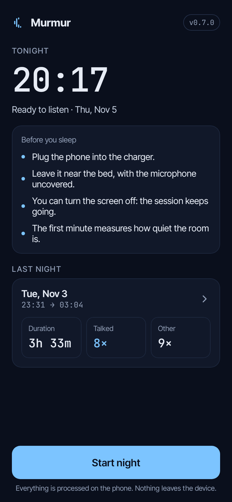
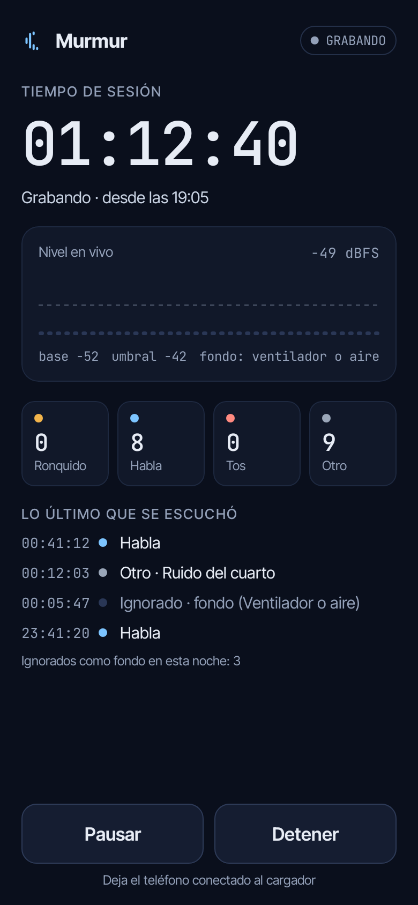
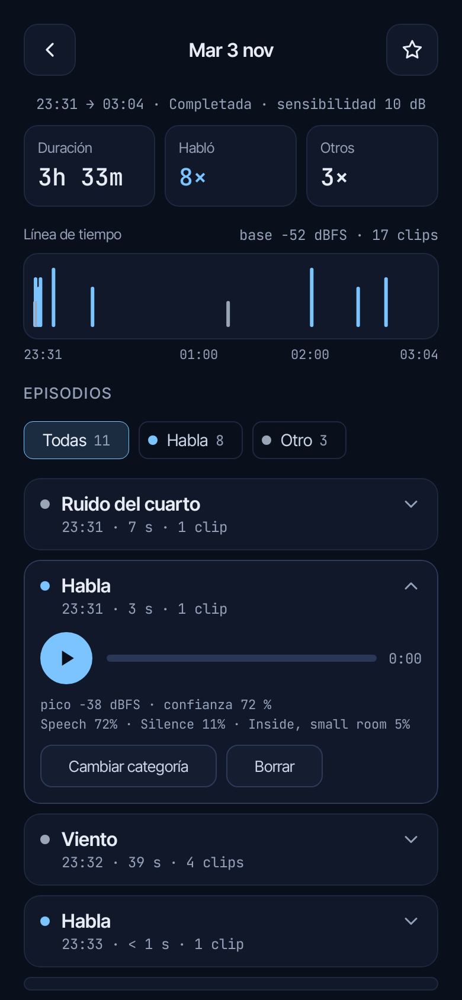
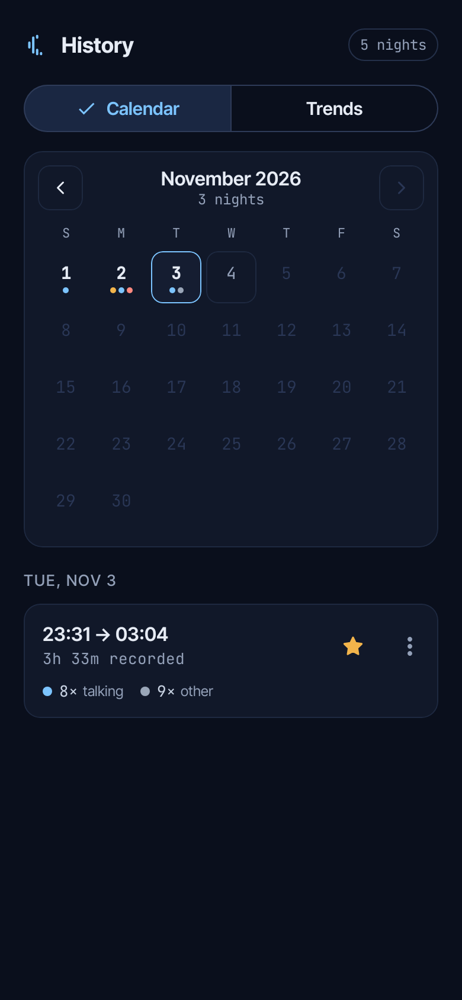
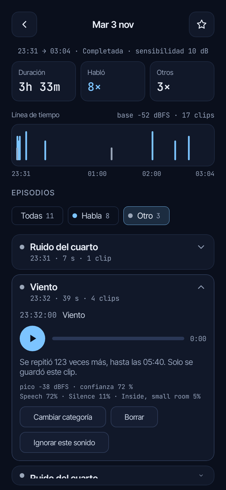
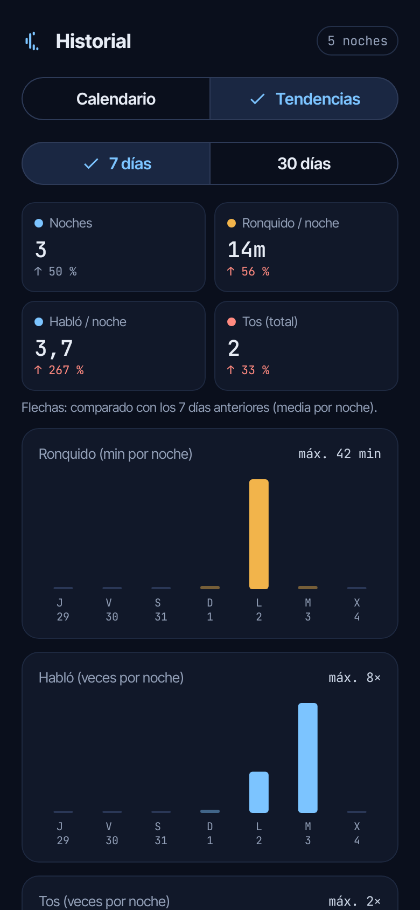

# Murmur

**A private sleep sound recorder for Android.** Murmur listens through the night, keeps only the sounds that matter (snoring, sleep talking, coughing and other noises), ignores silence and steady background noise, and lets you review and replay them in the morning.

Everything runs on the phone. The APK does not declare the `INTERNET` permission, so no audio, transcript or statistic can leave the device.

<p>
  
  
  
  
</p>

## Features

- **Smart detection.** The first minute calibrates to the room. After that, only sounds louder than the room's baseline are recorded, each with 3 s of audio before and 2 s after.
- **On-device classification.** [YAMNet](https://www.kaggle.com/models/google/yamnet) (Google's audio classifier, run with MediaPipe) sorts every clip into **Snoring**, **Talking**, **Coughing** or **Other**, and names other sounds (dog, door, rain, fan, TV…; 28 types). Background noise is discarded.
- **Sleep-talk transcription.** Talking clips are transcribed with Android's on-device speech recognizer (Android 13+). Before recognition, each clip is trimmed, boosted to conversation level and split into phrases.
- **Clean nights.**
  - **Repeated noises:** wind, a fan, rain or room noise are saved once and later repeats are only counted ("heard 123 more times, until 5:40").
  - **Ignored sounds:** any sound can be added to an ignore list from one of its clips, optionally deleting the clips already saved.
  - **Never lost:** clips that also contain talking, snoring or coughing are always saved.
- **Morning review.**
  - Timeline of the night, with episodes grouped by category.
  - Filter by category, play any clip, and correct or delete it.
  - Optional full-night recording.
- **History and trends.** A monthly calendar of nights, plus snoring minutes and talking episodes over time. Favorite nights are kept by the retention policy.
- **Outside the app.**
  - Pause and resume from the notification, including on the lock screen.
  - A morning summary notification.
  - A Quick Settings tile and a home-screen widget.
- **Spanish and English**, switchable in Settings.

<p>
  
  
  
</p>

## Privacy

- No network access. The `INTERNET` and `ACCESS_NETWORK_STATE` permissions are explicitly removed from the merged manifest.
- No cloud backup. `allowBackup="false"`, and `data_extraction_rules.xml` excludes all data from cloud backup and device transfer.
- Audio is stored as WAV clips in the app's private storage. Retention is configurable: forever, 7 days or 30 days, and favorite nights are never deleted.
- The YAMNet model (`app/src/main/assets/yamnet.tflite`) ships inside the APK. It was downloaded once from Google's MediaPipe model storage when the project was set up.

## Building

Requirements: a recent Android Studio (it bundles JBR 21) with **Android SDK 37** (platform `android-37.0`). The app runs on Android 8.0 (API 26) or newer.

1. Open the project folder in Android Studio and let Gradle sync (wrapper 9.8.2, AGP 9.5.0).
2. Run it on a device.

From the command line, set `JAVA_HOME` to a JDK 17+ and `ANDROID_HOME` to the SDK (or add a `local.properties` with `sdk.dir=...`):

```bash
./gradlew test
```

```bash
./gradlew assembleDebug
```

```bash
./gradlew lintDebug
```

To regenerate the screenshots (written to `app/build/screenshots`):

```bash
NS_SCREENSHOTS=1 ./gradlew testDebugUnitTest --tests '*ScreenshotTest*'
```

## Project structure

```
app/src/main/java/com/nochesonora/
├─ core/            Pure Kotlin (no android.*): PCM, WAV, ADTS, baseline, event detector,
│                   windowing, label mapping, snore heuristic, voting, episodes,
│                   repeat and ignore filters
├─ audio/           AudioRecord, YAMNet (MediaPipe), full-night AAC/ADTS recording, interruptions
├─ service/         Foreground service, session engine, live state, notifications, tile, widget
├─ transcription/   On-device speech recognition and speech preprocessing
├─ data/            Room (DB v4), DataStore, audio files, retention, single repository
└─ ui/              Compose: Home, History, Night detail, Settings, Diagnostics
```

- Simple MVVM with one repository and manual dependency injection (`AppContainer`), without Hilt.
- The internal package is still `com.nochesonora` (the app's original name, NocheSonora), so updates install over earlier builds and keep recorded nights. The Spanish UI strings live in `res/values/` (Spanish is the default locale) and the English ones in `res/values-en/`.

## Status

| What | Status |
|---|---|
| Version | **0.8.0** (versionCode 11) |
| Unit tests | **140 JVM tests passing**, including a full session simulated with Robolectric, plus 15 screenshot tests (Spanish and English) |
| Lint | 0 errors. 23 warnings, all known, including the deliberate `OldTargetApi` (targetSdk 36, see A28) and `BatteryLife` (A16); most of the rest are plural suggestions and library update notices |
| APK permissions | No `INTERNET`, no `ACCESS_NETWORK_STATE` |
| Instrumented tests | Not run (they need a device or emulator) |
| Real-device testing | In use on a phone since 2026-11-03. The first night with 0.2.0 recorded 17 clips; issues found on the phone are listed in `plan.md` §12 |

### Changelog

| Version | Changes |
|---|---|
| 0.3.0 | "Murmur · Instrument" design: night blue, Inter Tight + JetBrains Mono (OFL, bundled), bar meter, clip waveform |
| 0.3.1 | Renamed to **Murmur** |
| 0.4.0 | History as a monthly calendar, visible calibration minute, Spanish / English setting |
| 0.5.0 | Pause / resume from the notification, morning summary, Quick Settings tile, widget, trends, sleep-talk transcription, 28 sound types (DB v2) |
| 0.5.1 | "Moon of bars" logo |
| 0.5.2 | More reliable transcription: trimming, gain, per-phrase recognition |
| 0.6.0 | Repeated ambient noises saved once; category filter in the night detail (DB v3) |
| 0.7.0 | Ignored sounds, chosen from a clip, with optional cleanup of saved clips |
| 0.8.0 | Code, comments and plan in English; stored values renamed to English with a migration that keeps existing nights (DB v4) |

The full specification and the notes for each version are in [`plan.md`](plan.md) (in Spanish).

## Design decisions

These resolve ambiguities in the original specification (`plan.md` §1.2):

| # | Ambiguity / problem | Decision |
|---|---|---|
| A1 | No package structure was given. | The one in `plan.md` §3. |
| A2 | MediaPipe in `AUDIO_CLIPS` mode splits audio into 0.975 s windows with no overlap; the requirement asks for 50 %. | Manual windowing: `classify()` on exactly 15,600 samples per window, advancing 7,800. |
| A3 | "Sustained engine" was undefined. | `Engine`, `Idling` and `Engine starting` count as BACKGROUND only if they appear (≥ 0.30) in ≥ 70 % of windows; otherwise as OTHER. |
| A4 | `Breathing` counts as SNORING "only if periodic". What if it isn't? | If not periodic, it votes as OTHER (with its original label). |
| A5 | No window scores above 0.30. | OTHER with the label `Unknown`; the clip is not discarded. |
| A6 | 2 s post-roll vs. 2.5 s hangover. | Clip = [start − 3 s, last active block + 2 s]. The audio is already in memory when the event closes. |
| A7 | Cut at 60 s. | The cut event ends at second 60 without post-roll; the next one starts at that instant without pre-roll (contiguous audio). |
| A8 | "Consecutive events" for episodes. | Sorted by time; an event joins the episode if the previous event has the same effective category (`userCategory ?: category`) and the gap is < 30 s. |
| A9 | Recording pauses. | A `PauseEntity` table. |
| A10 | Android 14+ does not allow restarting a microphone foreground service on its own. | `START_NOT_STICKY`; if the process dies, the session is marked INTERRUPTED. |
| A11 | `full.m4a` is corrupted if the process dies. | The full night is recorded as AAC **ADTS** (`full.aac`), playable even if cut off. ExoPlayer seeks with *constant bitrate seeking*. A deliberate deviation from the requirement. |
| A12 | "Live" panel without a session. | "No active session"; only "Test 10 seconds", disabled during a session. |
| A13 | Warning when less than 500 MB is free. | A "Cancel" / "Start anyway" dialog. |
| A14 | When to apply retention. | When the app opens, when each session ends and when the setting changes (no WorkManager). |
| A15 | `MIC` applies AGC/NS and distorts the baseline. | `UNPROCESSED` if the device supports it; otherwise `VOICE_RECOGNITION`. |
| A16 | Battery optimization exemption. | Requested once, after an explanation, with `ACTION_REQUEST_IGNORE_BATTERY_OPTIMIZATIONS`; if that fails, the settings screen. The app is not distributed on the Play Store, so its policy on that permission does not apply. |
| A17 | Manual correction to BACKGROUND. | The picker only offers SNORING / TALKING / COUGHING / OTHER; to remove something, use "Delete". |
| A18 | Episode category after a correction. | The session's episodes are regrouped after every correction or deletion. |

Additional decisions made during implementation:

| # | Problem found | Decision |
|---|---|---|
| A19 | If the baseline froze during every event, a fan turning on would create one continuous event, cut every 60 s forever, and the baseline would never rise: exactly the avalanche to avoid. | The baseline freezes during an event **unless** it continues a 60 s cut (a sustained level). With a +15 dB fan there are about 3 events (discarded as BACKGROUND) and it is absorbed in ~2 min. Covered by `fanTurningOnIsAbsorbedWithoutAvalanche`. |
| A20 | Snore heuristic peaks: with "local maxima ≥ 1.5 s apart", a pulse every 1 s looked periodic every 2 s, and a snore every 2 s could merge with the next. | One peak per burst (a continuous stretch above median + 6 dB); bursts < 1.5 s after the previous one are chained into it. |
| A21 | Race between cleaning up orphaned sessions at startup and a session created at that moment. | Only IN_PROGRESS sessions created before the current process started are marked INTERRUPTED. |
| A22 | Some devices silently deliver zeros, without `isClientSilenced`, when another app takes the microphone. | 2 s of exact digital zeros also opens a `MIC_BUSY` (microphone busy) pause. A real room never produces exact zeros. |
| A23 | A continuation after a 60 s cut that never crosses the threshold again would give a zero-length event. | It is discarded. |
| A24 | If YAMNet fails to load (damaged model, unsupported ABI), the night would be lost. | The session continues and saves events as OTHER / `Unclassified`; Home shows a warning. |
| A25 | `plan.md` §2 mixed up two versions (lifecycle 2.10.2 and navigation 2.11.0 don't exist). | lifecycle **2.11.0**, navigation-compose **2.10.2** (verified on Google Maven). |
| A26 | Event end time in the database. | `startedAt` / `endedAt` are the real start and end (without pre/post-roll); the WAV includes the rolls. |
| A27 | Manifest safety. | `tools:node="remove"` on `INTERNET` and `ACCESS_NETWORK_STATE`, in case a dependency adds them to the merged manifest. |
| A28 | The plan asked for compileSdk 36 as "latest stable", but API 37 is out and the 2026 libraries (Compose 1.12, core 1.19, lifecycle 2.11, navigation 2.10) refuse to compile against 36. | **compileSdk 37**. **targetSdk stays at 36**, as the plan says: raising it would turn on Android 17 behavior changes that haven't been tested on a phone. |

## Manual validation checklist

From `plan.md` §8.3:

1. [ ] Diagnostics → "Test 10 s" while talking, coughing and with the fan on.
2. [ ] A 15-minute session with the fan on the whole time → 0 BACKGROUND events saved.
3. [ ] Turn the fan on mid-session → the baseline rises without an avalanche of events.
4. [ ] During a session, open the voice recorder or take a call → the pause is recorded and the session resumes automatically.
5. [ ] Force-stop the app from system Settings → on reopening, the session shows as INTERRUPTED at the time of the last heartbeat.
6. [ ] A full 8-hour night with "Save full recording": battery use, stable memory (no growth), and detected events compared with the recording.
7. [ ] Test on at least one Samsung or Xiaomi phone with default battery optimization.

Acceptance criteria are in `plan.md` §10.
